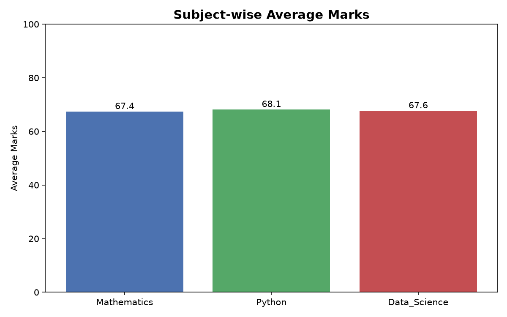
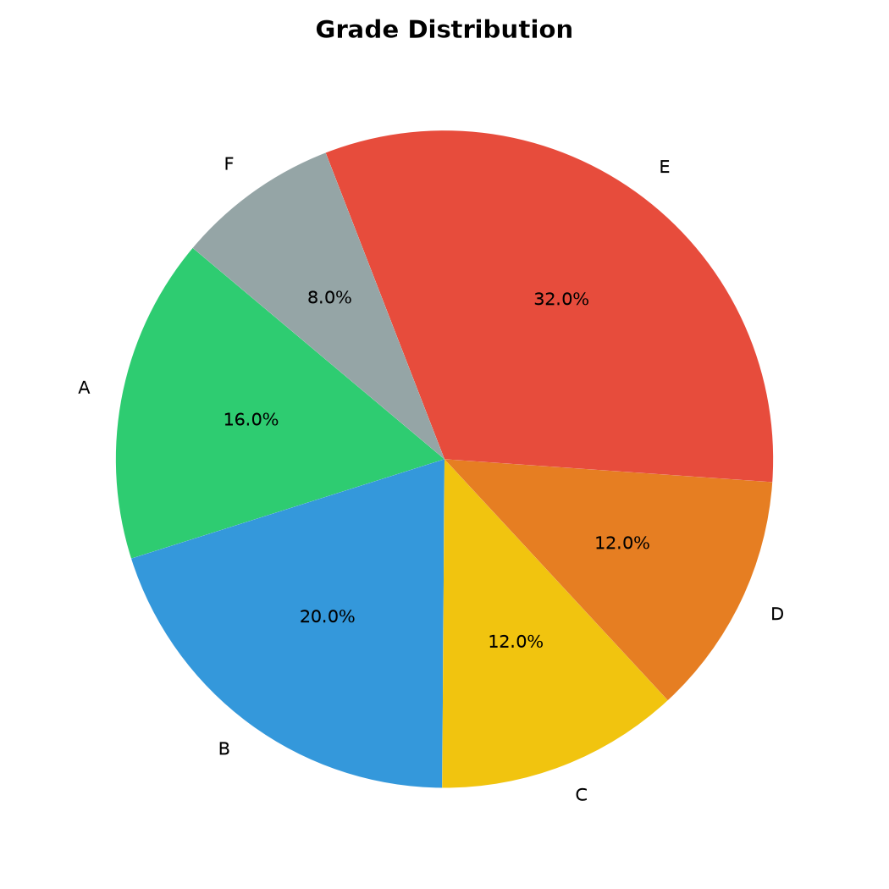
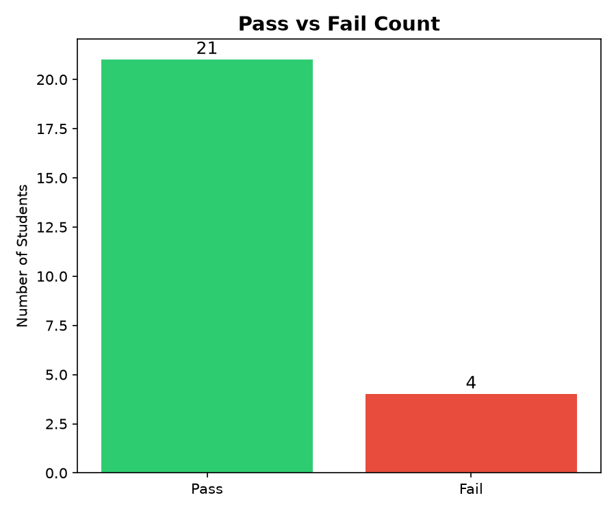
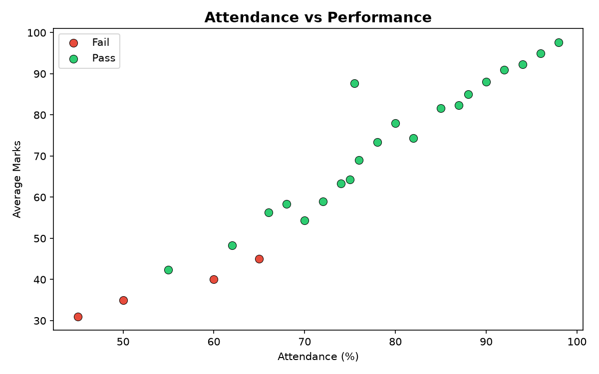

# 📄 Project Documentation — Student Performance Analytics System

---

## 1. Project Title

**Student Performance Analytics System**

A Python-based data analysis mini-project that processes student academic records and generates performance insights.

---

## 2. Objective

The objective of this project is to:

- Load student data from a CSV file using Pandas.
- Clean and validate the data, handling missing and invalid values.
- Calculate total marks, average marks, grades and pass/fail status for every student.
- Generate descriptive statistics (highest, lowest, average performance).
- Analyse attendance patterns and their correlation with academic results.
- Provide department-wise breakdowns of performance.
- Save the processed results to a new CSV file.
- Visualise key metrics using Matplotlib charts.

---

## 3. Technologies Used

| Technology | Version | Purpose |
|------------|---------|---------|
| Python | 3.9+ | Core programming language |
| Pandas | ≥ 2.0 | Data loading, filtering and manipulation |
| NumPy | ≥ 1.24 | Numerical calculations (sum, mean, correlation, rounding) |
| Matplotlib | ≥ 3.7 | Data visualisation (bar, pie, scatter charts) |
| CSV | — | Dataset format (plain-text, no database required) |

No database, cloud service, paid API or machine learning model is used.

---

## 4. Dataset Description

The project uses `students.csv` containing **25 student records** across **3 departments**:

- Computer Science (CS)
- Data Science (DS)
- Information Technology (IT)

### Columns

| Column | Data Type | Range | Notes |
|--------|-----------|-------|-------|
| Student_ID | String | S001–S025 | Unique identifier |
| Name | String | — | Full name |
| Department | String | — | CS / DS / IT |
| Mathematics | Float | 0–100 | Subject marks |
| Python | Float | 0–100 | Subject marks |
| Data_Science | Float | 0–100 | Subject marks |
| Attendance | Float | 0–100 | Attendance percentage |

The dataset intentionally includes **two missing values** to demonstrate real-world data cleaning scenarios.

---

## 5. Implementation Steps

### Step 1 — Data Loading
The CSV file is loaded using `pandas.read_csv()`. If the file is missing or empty, the program exits with a clear error message.

### Step 2 — Dataset Overview
First 5 rows, shape (rows × columns), column names and data types are printed for inspection.

### Step 3 — Missing Value Check
Each column is checked for NaN values using `df.isnull().sum()`.

### Step 4 — Duplicate Check
Duplicate `Student_ID` values are detected using `df.duplicated()`.

### Step 5 — Data Cleaning
1. Whitespace is stripped from text columns.
2. Marks and attendance are validated to be numbers in the range [0, 100]. Out-of-range or non-numeric values are set to NaN (never silently converted to zero).
3. Exact duplicate rows are removed.
4. Remaining NaN values are filled with the column **median** — a fair imputation strategy that avoids extreme bias.

Every cleaning decision is printed so the user can verify the transformations.

### Step 6 — Total & Average Marks
`Total_Marks` = sum of all three subjects.
`Average_Marks` = mean of all three subjects.

Both are computed using NumPy (`np.sum`, `np.mean`).

### Step 7 — Grade Assignment

| Grade | Condition |
|-------|-----------|
| A | Average ≥ 90 |
| B | 80 ≤ Average < 90 |
| C | 70 ≤ Average < 80 |
| D | 60 ≤ Average < 70 |
| E | 40 ≤ Average < 60 |
| F | Average < 40 |

### Step 8 — Pass/Fail Status
A student **passes** only if they score **≥ 40 in every subject** (Mathematics, Python, Data Science). This is independent of the overall grade — a student can receive grade D but still fail if one subject is below 40.

### Step 9 — Performance Statistics
Highest, lowest and overall average marks are calculated using NumPy. Subject-wise averages are also displayed.

### Step 10 — Top Students
The top 5 students are ranked by `Average_Marks` using `df.nlargest()`.

### Step 11 — Pass/Fail Summary
Total students, pass count, fail count and pass percentage are computed.

### Step 12 — Attendance Analysis
- **Correlation** between attendance and average marks is calculated using `np.corrcoef()`.
- Students are grouped into attendance buckets (Low / Medium / Good / Excellent) and the average marks for each bucket are compared.

### Step 13 — Department Analysis
Average marks and pass rates are calculated per department.

### Step 14 — Save Results
The cleaned and analysed DataFrame is saved to `student_performance_results.csv`.

### Step 15 — Generate Charts
Four charts are generated using Matplotlib:
1. **Subject-wise average marks** — bar chart
2. **Grade distribution** — pie chart
3. **Pass vs Fail** — bar chart
4. **Attendance vs Performance** — scatter plot

---

## 6. Key Features

1. **Modular code** — All reusable functions are in `functions.py`; the workflow is in `main.py`.
2. **Data validation** — Invalid marks are flagged, not silently zeroed.
3. **Clear output** — Every step is numbered and labelled with emoji markers.
4. **NumPy integration** — Summation, mean, rounding and correlation use NumPy.
5. **Pandas integration** — Data loading, filtering, grouping and exporting use Pandas.
6. **Error handling** — Graceful exit on missing file or empty dataset.
7. **Reusable functions** — Functions accept parameters and return values, enabling easy testing.
8. **Charts** — Four professional charts saved as PNG files.

---

## 7. Output Screenshots

> *Replace the placeholders below with actual screenshots after running the project.*

### Terminal Output

### Subject Averages Chart

### Grade Distribution Chart

### Pass vs Fail Chart

### Attendance vs Performance Chart

---

## 8. Final Outcome

The project successfully:
- Loads and cleans a 25-record student dataset.
- Calculates grades and pass/fail status for all students.
- Produces summary statistics and department-wise analysis.
- Saves processed results to `student_performance_results.csv`.
- Generates four data visualisation charts.

All calculations are verified to be correct and consistent.

---

## 9. Challenges and Learning

### Challenges Faced
1. **Handling missing data** — Choosing between dropping rows and filling with median required understanding the trade-offs of each approach.
2. **Separating grade from pass/fail** — A student can have a passing grade (e.g., D) but still fail because one subject is below 40. Implementing this distinction required careful conditional logic.
3. **Data validation without silent conversion** — Ensuring invalid marks are flagged as NaN rather than silently set to zero required custom validation logic.
4. **Chart formatting** — Making charts readable with proper labels, colours and layouts required iterating on Matplotlib settings.

### What I Learned
- How to load, clean and analyse data using Pandas and NumPy.
- The importance of documenting every data cleaning decision.
- How to use conditional logic (if/elif/else) for grading.
- How to use reusable functions to avoid duplicate code.
- How to generate and save charts with Matplotlib.
- How to structure a Python project with separate files for functions and main logic.
- How to use Git and GitHub for version control.

---

## 10. GitHub Repository

> **Repository Link:** `https://github.com/YOUR_USERNAME/student-performance-analytics`

*(Replace `YOUR_USERNAME` with your actual GitHub username after uploading the project.)*

---

*Document prepared as part of the Python with AI course assignment.*

